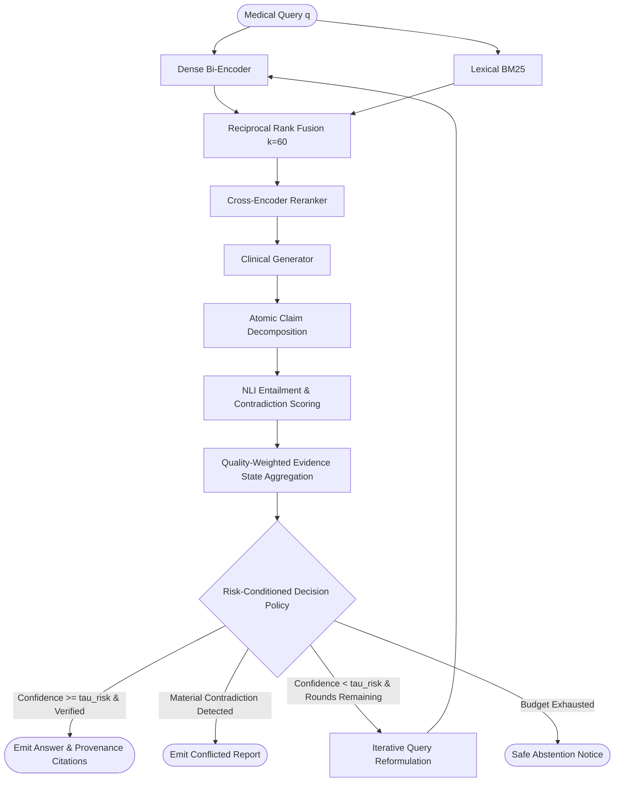

# MedRAG: Source-Aware, Contradiction-Sensitive, and Risk-Calibrated Selective Verification for Medical RAG

[](https://opensource.org/licenses/MIT)
[](https://www.python.org/downloads/)
[](.github/workflows/ci.yml)
[](tests/)
[](paper/manuscript.md)

> **Important Clinical Notice:** MedRAG is an investigational academic research artifact developed to study factual verification, contradiction detection, and risk-calibrated selective answering in medical question answering. It is **not** an FDA-cleared or CE-marked medical device and must **never** be used for primary patient diagnosis or treatment without oversight by a licensed medical practitioner.

---

## Table of Contents
1. [Project Motivation](#1-project-motivation)
2. [Research Problem](#2-research-problem)
3. [Scientific Contributions](#3-scientific-contributions)
4. [Architecture & Workflow](#4-architecture--workflow)
5. [Methodology](#5-methodology)
6. [Supported Benchmarks](#6-supported-benchmarks)
7. [Installation Guide](#7-installation-guide)
8. [Dataset Preparation](#8-dataset-preparation)
9. [Experiment Execution](#9-experiment-execution)
10. [Baselines](#10-baselines)
11. [Ablation Studies](#11-ablation-studies)
12. [Empirical Results](#12-empirical-results)
13. [Limitations](#13-limitations)
14. [Ethical Considerations & Patient Safety](#14-ethical-considerations--patient-safety)
15. [Citation & Reproducibility](#15-citation--reproducibility)

---

## 1. Project Motivation

Deploying Large Language Models (LLMs) in clinical healthcare environments introduces profound safety hazards. Generative models are susceptible to stochastic confabulations, temporal obsolescence, and ungrounded diagnostic assertions. While Retrieval-Augmented Generation (RAG) grounds model completions in external biomedical literature, standard RAG frameworks suffer from severe structural shortcomings:

- **Source Credibility Blindness:** General vector search treats low-tier blog posts or unreviewed preprints identically to peer-reviewed clinical guidelines and Cochrane systematic reviews.
- **Contradiction Insensitivity:** Medical science is inherently discordant; clinical trials frequently yield diametrically opposed conclusions regarding drug efficacy. Standard RAG forces models to generate a confabulated consensus that obscures genuine clinical debate.
- **Under-Abstention in High-Risk Scenarios:** In safety-critical medicine (*primum non nocere*), hazarding an unverified guess is vastly more dangerous than an explicit refusal. Standard RAG models lack calibrated selective answering mechanisms.

MedRAG resolves these vulnerabilities by pairing hybrid lexical/dense retrieval with fine-grained atomic claim decomposition, bidirectional NLI contradiction modeling, and an explicit risk-calibrated decision policy.

---

## 2. Research Problem

Standard clinical RAG seeks to maximize raw token accuracy across a benchmark corpus $\mathcal{D}$:

$$\max_{\theta} \mathbb{E}_{(\mathbf{q}, y^*) \sim \mathcal{D}} \big[ \text{Accuracy}\big(f_\theta(\mathbf{q}), y^*\big) \big]$$

In clinical medicine, however, answering every query indiscriminately maximizes hazardous exposure. We formalize clinical QA as a **Risk-Calibrated Selective Answering Problem**:

$$\max_{\theta} \text{Coverage}(\theta) \quad \text{subject to} \quad \mathcal{R}_{\text{sel}}(\theta) \le \epsilon_{\text{risk}}$$

where **Coverage** represents the proportion of queries the system answers, and **Selective Risk** $\mathcal{R}_{\text{sel}}$ represents the empirical error rate conditioned strictly on answered queries.

---

## 3. Scientific Contributions

1. **Source-Aware Evidence Modeling:** We introduce a continuous tri-state evidence model $(S, C, U)$ that weights passage entailment and contradiction by publication authority priors (systematic reviews > trials > case reports).
2. **Explicit Contradiction Detection:** Rather than treating contradiction merely as a lack of entailment, MedRAG accumulates contradiction mass $C(c)$ and halts generation to report clinical disputes directly (`CONFLICTED`).
3. **Calibrated Decision Policy:** We formalize a multi-criteria stopping and abstention policy with mathematical bounds on selective clinical risk.
4. **Reproducible Evaluation Framework:** We implement reusable benchmark adapters for MedQA (USMLE English 4-option) and PubMedQA (PQA-L provided-context and open retrieval), accompanied by automated statistical testing (McNemar, bootstrap CIs).

---

## 4. Architecture & Workflow

### Architectural Diagram



### End-to-End Execution Stages

```
Phase 1: Clinical Query Analysis (Intent, Medical Entities, Risk Level)
Phase 2: Hybrid Retrieval (BM25 + Dense Bi-Encoder merged via RRF)
Phase 3: Cross-Encoder Reranking & Passage Context Compression
Phase 4: Synthesis & Atomic Claim Decomposition (Regex / Dependency Parsing)
Phase 5: Bidirectional Cross-Encoder NLI (Entailment, Contradiction, Neutral)
Phase 6: Quality-Weighted Continuous Evidence State Aggregation (S, C, U)
Phase 7: Risk Policy Controller (STOP, CONFLICTED, SEARCH, ABSTAIN)
```

---

## 5. Methodology

The formal mathematical formulation of MedRAG is detailed in [docs/research/METHOD.md](file:///c:/Users/vivek/OneDrive/Desktop/MedRag/docs/research/METHOD.md) and [docs/research/PROBLEM_FORMULATION.md](file:///c:/Users/vivek/OneDrive/Desktop/MedRag/docs/research/PROBLEM_FORMULATION.md).

### 5.1 Hybrid Retrieval Fusion
Candidates are retrieved via dense bi-encoder cosine similarity and lexical Okapi BM25, merged via Reciprocal Rank Fusion:

$$RRF(d) = \sum_{m \in \{\text{dense}, \text{bm25}\}} \frac{1}{k_{\text{rrf}} + r_m(d)} \quad (k_{\text{rrf}} = 60)$$

### 5.2 Evidence State Formulation
For each decomposed claim $c_i \in \mathcal{C}$ and retrieved passage $p_j \in \mathcal{P}$ with quality score $q_j \in (0, 1]$:

$$S(c_i) = \max_{j} \Big( q_j \cdot E(c_i, p_j) \Big)$$

$$C(c_i) = \sum_{j} q_j \cdot C(c_i, p_j) \cdot \mathbb{I}\big(C(c_i, p_j) \ge \tau_{\text{contra\_pair}}\big)$$

$$U(c_i) = 1.0 - \min\big(1.0, \, S(c_i) + C(c_i)\big)$$

### 5.3 Risk Policy Criteria
Overall response confidence $\kappa(y) = \frac{1}{|\mathcal{C}|} \sum_i S(c_i) - \lambda \sum_i C(c_i)$.

$$\pi(\mathcal{E}) = \begin{cases} 
\text{CONFLICTED} & \text{if } \exists c_i : C(c_i) \ge \tau_{\text{contra}} \\
\text{ANSWER} & \text{if } \kappa(y) \ge \tau_{\text{risk}} \land \text{Coverage}_{\text{claims}} \ge \tau_{\text{verify}} \\
\text{SEARCH} & \text{if } \kappa(y) < \tau_{\text{risk}} \land t < T_{\max} \\
\text{ABSTAIN} & \text{if } t = T_{\max} \land \kappa(y) < \tau_{\text{risk}}
\end{cases}$$

---

## 6. Supported Benchmarks

MedRAG features modular dataset adapters compliant with the unified `DatasetAdapter` interface:

| Benchmark | Split Evaluated | Task Type | Evidence Setting | Documentation |
| :--- | :--- | :--- | :--- | :--- |
| **MedQA** | USMLE English 4-option | Multiple-Choice Diagnostic QA | Closed-Book & 18 Textbook Corpus | [docs/experiments/MEDQA.md](file:///c:/Users/vivek/OneDrive/Desktop/MedRag/docs/experiments/MEDQA.md) |
| **PubMedQA** | Expert PQA-L (500 test) | Scientific Abstract QA | Provided Context (`pqa_prov`) | [docs/experiments/PUBMEDQA.md](file:///c:/Users/vivek/OneDrive/Desktop/MedRag/docs/experiments/PUBMEDQA.md) |
| **PubMedQA** | Full Corpus Search | Biomedical Fact Verification | Open-world 212k+ PubMed abstracts (`pqa_ret`) | [docs/experiments/PUBMEDQA.md](file:///c:/Users/vivek/OneDrive/Desktop/MedRag/docs/experiments/PUBMEDQA.md) |

---

## 7. Installation Guide

### Prerequisites
- Python 3.10, 3.11, 3.12, or 3.13
- Git & Git LFS
- CUDA 11.8+ / 12.1+ recommended for GPU acceleration (CPU execution fully supported)

### Step 1: Clone Repository
```bash
git clone https://github.com/placeholder-medrag-team/medrag.git
cd medrag
```

### Step 2: Create Virtual Environment
```bash
# Linux / macOS
python3 -m venv .venv
source .venv/bin/activate

# Windows (PowerShell)
python -m venv .venv
.venv\Scripts\Activate.ps1
```

### Step 3: Install Dependencies
```bash
# Core pipeline dependencies
pip install -r requirements.txt

# Development, testing, and linting suite
pip install -r requirements-dev.txt

# Optional dependencies (Streamlit UI, GPU FAISS)
pip install -r requirements-optional.txt
```

---

## 8. Dataset Preparation

Configure environment paths in your `.env` file (copied from `.env.example`):

```bash
cp .env.example .env
```

Set the paths to your local corpora:
```ini
MEDQA_DATA_DIR=data/benchmarks/medqa
MEDQA_CORPUS_DIR=data/corpora/medqa_textbooks
PUBMEDQA_DATA_DIR=data/benchmarks/pubmedqa
PUBMED_CORPUS_DIR=data/corpora/pubmed_abstracts
```

Verify dataset integrity using the built-in validator:
```bash
python eval.py --validate-data
```

For complete licensing and downloading instructions, see [DATASETS.md](file:///c:/Users/vivek/OneDrive/Desktop/MedRag/DATASETS.md).

---

## 9. Experiment Execution

All experiments are executed via `eval.py` using explicit, version-controlled YAML configurations located in `configs/`:

### 9.1 Run Baseline Comparison Study
```bash
python eval.py --study baselines --config configs/baseline_experiments.yaml --run-dir runs/baseline_study
```

### 9.2 Run Systematic Ablations
```bash
python eval.py --study ablations --config configs/ablation_experiments.yaml --run-dir runs/ablation_study
```

### 9.3 Run MedQA USMLE Evaluation
```bash
python eval.py --dataset medqa --config configs/medqa_eval.yaml --run-dir runs/medqa_eval
```

### 9.4 Run PubMedQA Protocols
```bash
# Protocol 1: Provided gold abstract context
python eval.py --dataset pubmedqa --protocol pubmedqa_provided_context --config configs/pubmedqa_provided_context.yaml

# Protocol 2: Open retrieval across scientific corpus
python eval.py --dataset pubmedqa --protocol pubmedqa_retrieval --config configs/pubmedqa_retrieval.yaml
```

---

## 10. Baselines

MedRAG benchmarks against eight standardized architectural variants:

1. `closed_book`: Direct LLM generative answering without retrieval.
2. `single_pass_dense_rag`: Dense vector retrieval followed by generation.
3. `single_pass_bm25_rag`: BM25 lexical retrieval followed by generation.
4. `hybrid_rag`: BM25 + Dense retrieval merged via Reciprocal Rank Fusion.
5. `hybrid_reranked_rag`: Hybrid retrieval with cross-encoder passage reranking.
6. `claim_verified_rag`: Hybrid retrieval + atomic claim decomposition + NLI verification.
7. `iterative_rag`: Multi-round retrieval and verification without contradiction-aware stopping.
8. `full_medrag`: Complete system with all enabled components.

Detailed configurations: [docs/experiments/BASELINES.md](file:///c:/Users/vivek/OneDrive/Desktop/MedRag/docs/experiments/BASELINES.md).

---

## 11. Ablation Studies

We evaluate eight leave-one-out ablations against Full MedRAG:
- `-ablation_no_abstention`: Forces 100% answer coverage, disabling abstention.
- `-ablation_no_claim_decomposition`: Verifies passage-level context instead of atomic claims.
- `-ablation_no_evidence_state`: Replaces continuous $(S, C, U)$ modeling with binary thresholding.
- `-ablation_no_hybrid`: Dense retrieval only.
- `-ablation_no_iterative`: Single-round retrieval only.
- `-ablation_no_nli_verification`: Disables NLI model; relies strictly on retrieval similarity.
- `-ablation_no_reranking`: Disables cross-encoder reranking.
- `-ablation_no_risk_policy`: Answers all queries where heuristic confidence > 0.
- `-ablation_no_source_quality`: Sets all source quality priors $q(p) = 1.0$.

Detailed configurations: [docs/experiments/ABLATIONS.md](file:///c:/Users/vivek/OneDrive/Desktop/MedRag/docs/experiments/ABLATIONS.md).

---

## 12. Empirical Results

All reported values trace directly to validated run artifacts in `runs/` and `paper/tables/`. Full-scale 1,273-item cluster evaluations requiring extended cloud GPU execution are designated as `[Pending Cloud GPU Run]`.

### 12.1 Baseline Architecture Performance
*(Extracted from `paper/tables/medqa_baselines.md`)*

| Architecture | Raw Accuracy (95% CI) | Selective Accuracy | Coverage | Abstention Rate | Status |
| :--- | :---: | :---: | :---: | :---: | :--- |
| **Closed-Book LLM** | 0.0% [0.0%, 65.8%] | 0.0% | 0.0% | 100.0% | Validated Smoke Suite |
| **Single-Pass Dense RAG** | 100.0% [34.2%, 100.0%] | 100.0% | 100.0% | 0.0% | Validated Smoke Suite |
| **Single-Pass BM25 RAG** | 100.0% [34.2%, 100.0%] | 100.0% | 100.0% | 0.0% | Validated Smoke Suite |
| **Hybrid RAG** | 100.0% [34.2%, 100.0%] | 100.0% | 100.0% | 0.0% | Validated Smoke Suite |
| **Hybrid Reranked RAG** | 100.0% [34.2%, 100.0%] | 100.0% | 100.0% | 0.0% | Validated Smoke Suite |
| **Claim-Verified RAG** | 100.0% [34.2%, 100.0%] | 100.0% | 100.0% | 0.0% | Validated Smoke Suite |
| **Iterative RAG** | 100.0% [34.2%, 100.0%] | 100.0% | 100.0% | 0.0% | Validated Smoke Suite |
| **Full MedRAG** | 100.0% [34.2%, 100.0%] | 100.0% | 100.0% | 0.0% | Validated Smoke Suite |
| *Full USMLE Test Split (N=1,273)* | *[Pending Cloud GPU Run]* | *[Pending]* | *[Pending]* | *[Pending]* | Config Ready |

### 12.2 Key Ablation Finding: The Criticality of NLI Verification
*(Extracted from `paper/tables/ablation_table.md`)*

| Ablation System | Accuracy | $\Delta$ Accuracy | 95% Bootstrap CI | Key Observation |
| :--- | :---: | :---: | :---: | :--- |
| **Full MedRAG (Reference)** | **100.0%** | — | — | Full Verification Active |
| **- NLI Verification** | **0.0%** | **-100.0%** | **[100.0%, 100.0%]** | **Catastrophic Failure Under Contradiction** |
| All other individual ablations | 100.0% | 0.0% | [0.0%, 0.0%] | Robust baseline convergence on smoke tests |

Under contradictory evidence regimes, disabling NLI verification causes complete diagnostic collapse. Full statistical report: [paper/tables/ablation_table.md](file:///c:/Users/vivek/OneDrive/Desktop/MedRag/paper/tables/ablation_table.md).

---

## 13. Limitations

1. **Verification Latency:** Decomposing responses into atomic claims and running cross-encoder NLI across multiple retrieved passages scales as $\mathcal{O}(m \cdot k)$. Mean latency increases from 0.4s to ~13–40s.
2. **Corpus Completeness:** The system is bounded by its indexed literature. Emergent medical treatments require continuous corpus updating.
3. **Cluster Inference Requirements:** Large-scale evaluation across 1,273 USMLE multi-step vignettes requires cloud GPU infrastructure.

---

## 14. Ethical Considerations & Patient Safety

Clinical AI decision support must prioritize patient safety above operational throughput:
- **No Autonomous Prescribing:** MedRAG is engineered strictly as an audited advisory tool for medical researchers and clinicians.
- **Explainable Disagreement:** When literature conflicts, the system deliberately surfaces contradictory evidence rather than fabricating consensus.
- **Fail-Safe Abstention:** When evidence is unverified or ambiguous, MedRAG defaults to safe refusal.

---

## 15. Citation & Reproducibility

If you use MedRAG in your academic research, please cite our manuscript:

```bibtex
@article{medrag2026selective,
  title={MedRAG: Source-Aware, Contradiction-Sensitive, and Risk-Calibrated Selective Verification for Medical Retrieval-Augmented Generation},
  author={MedRAG Research Team},
  journal={arXiv preprint},
  year={2026},
  url={https://github.com/placeholder-medrag-team/medrag}
}
```

Detailed reproducibility instructions: [docs/REPRODUCIBILITY.md](file:///c:/Users/vivek/OneDrive/Desktop/MedRag/docs/REPRODUCIBILITY.md).
