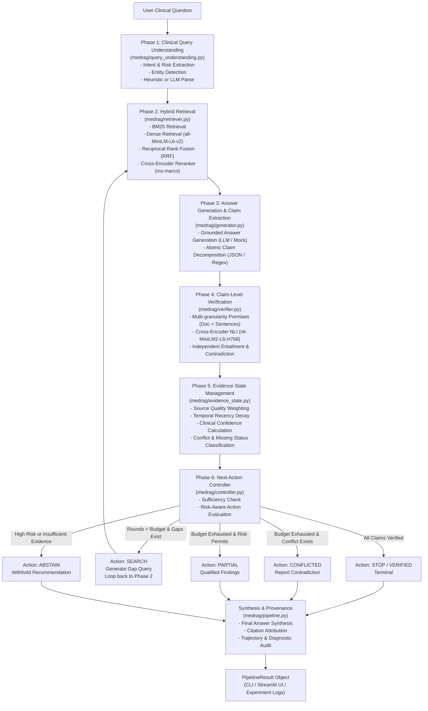

# MedRAG System Source-Code & Research-Readiness Audit

**Date:** November 2026  
**Auditor:** Lead Research Engineer  
**Scope:** Complete repository inspection (`medrag/`, `config.py`, `app.py`, `main.py`, `tests/`, dependencies, workflows)

---

## 1. Executive Summary

MedRAG is an adaptive, evidence-aware retrieval-augmented generation framework designed for clinical question answering. The codebase implements a 6-phase pipeline spanning query understanding, hybrid retrieval (BM25 + Dense + Reranking), answer generation, atomic claim decomposition, multi-granularity NLI verification, evidence state tracking, and next-action decision control (`STOP`, `PARTIAL`, `CONFLICTED`, `SEARCH`, `ABSTAIN`).

While the conceptual architecture addresses critical requirements for reliable medical QA—specifically claim-level verification and risk-aware abstention—the current implementation has notable engineering discrepancies, metadata dropouts, provider switching bugs, and citation alignment mismatches that must be resolved prior to benchmark publication. Furthermore, standard benchmark dataset adapters (MedQA, PubMedQA), evaluation harnesses, baseline implementations, and statistical confidence estimation are not yet present.

---

## 2. Component Dependency Map (End-to-End Query Lifecycle)



### Detailed Trace of Query Processing:
1. **Input Stage:** A question string arrives via CLI (`main.py`), Streamlit (`app.py`), or programmatic call (`MedRagPipeline.answer`).
2. **Phase 1 (Query Understanding):** `ClinicalQueryUnderstanding.parse()` classifies clinical intent (diagnosis, treatment, safety, dosage, prognosis, mechanism), calculates risk tier (0.0 to 1.0) using rule-based keyword triggers (`CRITICAL_RISK_TERMS`, `HIGH_RISK_TERMS`) or LLM JSON parsing, and extracts entities and initial search queries.
3. **Phase 2 (Hybrid Retrieval):** `HybridRetriever.retrieve()` runs parallel queries:
   - BM25 lexical search over tokenized documents.
   - Dense semantic vector search via `all-MiniLM-L6-v2` cosine similarities.
   - Merging via Reciprocal Rank Fusion (`reciprocal_rank_fusion` with $k=60$).
   - Re-ranking the top-$k$ candidates with `cross-encoder/ms-marco-MiniLM-L-6-v2`.
4. **Phase 3 (Generation & Decomposition):** In Round 1, `AnswerGenerator.generate_answer()` formats the top reranked documents into a prompt (`_ANSWER_PROMPT`), queries the LLM (`LLMClient.complete`), and decomposes the response into discrete atomic claims (`decompose_claims`) via JSON schema prompt or fallback regex sentence splitting.
5. **Phase 4 (NLI Claim Verification):** `NLIVerifier.verify_claims()` extracts multi-granularity premises (full document + individual sentences with title context) for each retrieved document, scores `(premise, claim)` pairs across 3 logits `[contradiction, entailment, neutral]` using `cross-encoder/nli-MiniLM2-L6-H768`, applies softmax, and sorts supporting and contradicting passages independently.
6. **Phase 5 (Evidence State Tracking):** `EvidenceState` aggregates `ClaimEvidence` objects. It computes `clinical_confidence` for each claim incorporating maximum entailment, source quality score, recency penalty, and contradiction penalty. Claims are assigned statuses: `SUPPORTED`, `CONFLICTED`, `MISSING`, or `UNCERTAIN`.
7. **Phase 6 (Action Controller):** `EvidenceController.decide()` checks if all claims meet configured thresholds (`is_sufficient`). If yes, it emits `STOP`. If unresolved claims remain and retrieval budget permits ($round < max\_search\_rounds$), it emits `SEARCH` and generates a targeted gap query (`generate_gap_query`). When the retrieval budget is exhausted, it outputs `CONFLICTED`, `PARTIAL` (if risk $< high\_risk\_threshold$), or `ABSTAIN`.
8. **Synthesis & Output:** `_synthesize_final_answer()` compiles findings with citation provenance markers and packages everything into a `PipelineResult` with latency and trajectory history.

---

## 3. Implementation Problems & Verification

Each of the following issues was investigated and verified directly against the active implementation code:

### 3.1. Automatic LLM Backend Selection & Fallback in `main.py`
- **Location:** [`main.py` Lines 308-335](file:///c:/Users/vivek/OneDrive/Desktop/MedRag/main.py#L308-L335)
- **Code Finding:**
  ```python
  backend = args.backend if args.backend != "auto" else config.llm_backend
  ...
  if backend == "auto":
      if os.environ.get("GROQ_API_KEY"):
          backend = "groq"
      ...
  ```
- **Bug Analysis:** `MedRagConfig.from_env()` defaults `llm_backend` to `"groq"`. Consequently, when a user executes CLI with default `-b auto`, line 308 resolves `backend` to `"groq"` immediately. Line 322 (`if backend == "auto":`) is **dead code and unreachable**. If no `GROQ_API_KEY` is present in the environment, the CLI fails on Groq API calls rather than falling back to `"mock"` as intended by lines 331-333.

### 3.2. Provider Switching and API Key Resolution in Streamlit
- **Location:** [`app.py` Lines 152-179, 306-320](file:///c:/Users/vivek/OneDrive/Desktop/MedRag/app.py#L306-L320)
- **Code Finding:**
  ```python
  # Line 306:
  cfg = MedRagConfig.from_env()
  cfg.llm_backend = backend
  cfg.llm_model = model_name
  ...
  llm = LLMClient(
      backend=cfg.llm_backend,
      model=cfg.llm_model,
      api_key=cfg.llm_api_key,
      base_url=cfg.llm_base_url,
  )
  ```
- **Bug Analysis:** `MedRagConfig.from_env()` resolves credentials for the backend discovered at startup. When a user changes the backend in Streamlit (e.g., from `groq` to `openai`), line 307 sets `cfg.llm_backend = "openai"`, but `cfg.llm_api_key` remains populated with the initial `GROQ_API_KEY`, and `cfg.llm_base_url` remains Groq's endpoint `https://api.groq.com/openai/v1`. The application attempts to call OpenAI using Groq credentials and URLs, resulting in authentication failures.

### 3.3. Loss of Dense Ranking Metadata in RRF Fusion
- **Location:** [`medrag/retriever.py` Lines 169-187](file:///c:/Users/vivek/OneDrive/Desktop/MedRag/medrag/retriever.py#L169-L187)
- **Code Finding:**
  ```python
  for rank, rdoc in enumerate(bm25_results):
      did = rdoc.document.doc_id
      scores[did] = scores.get(did, 0.0) + bm25_weight / (k + rank + 1)
      doc_map[did] = rdoc

  for rank, rdoc in enumerate(dense_results):
      did = rdoc.document.doc_id
      scores[did] = scores.get(did, 0.0) + dense_weight / (k + rank + 1)
      doc_map.setdefault(did, rdoc)

  return [
      RetrievedDocument(
          document=doc_map[did].document,
          score=sc,
          bm25_rank=doc_map[did].bm25_rank,
          dense_rank=doc_map[did].dense_rank,
      )
      for did, sc in sorted(scores.items(), key=lambda x: -x[1])
  ]
  ```
- **Bug Analysis:** If a document is present in both BM25 and Dense result sets, `doc_map[did]` is populated by the BM25 loop where `dense_rank` is `None`. In the second loop, `doc_map.setdefault(did, rdoc)` does not update an existing key. Thus, the returned `RetrievedDocument` retains `bm25_rank` but loses `dense_rank` (`dense_rank` remains `None`). Furthermore, original raw BM25 scores and cosine similarity scores are completely discarded, preventing downstream rank-loss and calibration analysis.

### 3.4. Disconnect Between Prompt Citations and Final Provenance Synthesis
- **Location:** [`medrag/generator.py` Lines 406-413](file:///c:/Users/vivek/OneDrive/Desktop/MedRag/medrag/generator.py#L406-L413) vs. [`medrag/pipeline.py` Lines 388-399](file:///c:/Users/vivek/OneDrive/Desktop/MedRag/medrag/pipeline.py#L388-L399)
- **Code Finding:**
  In `generator.py`:
  ```python
  for i, rdoc in enumerate(retrieved_docs[:8]):
      entry = f"[{i+1}] {doc.title} ({doc.year}, {doc.source})\n{snippet}"
  ```
  In `pipeline.py`:
  ```python
  lines.append(f"  - [{passage.doc_id}] {passage.doc_title} — {passage.source}, {passage.year}")
  ```
- **Bug Analysis:** The LLM generator prompt instructs the model to cite documents using temporary list indices `[1], [2], ... [8]`. However, `_synthesize_final_answer` formats verified findings using permanent document IDs `[passage.doc_id]`. If `doc_id` is a PMID string (e.g. `pmid_34211`), citations generated in the raw text do not match the final synthesized provenance keys, leading to mismatched attribution in research evaluation.

### 3.5. Discrepancy Between `clinical_confidence` and `effective_support`
- **Location:** [`medrag/evidence_state.py` Lines 102-133](file:///c:/Users/vivek/OneDrive/Desktop/MedRag/medrag/evidence_state.py#L102-L133)
- **Code Finding:**
  ```python
  # clinical_confidence:
  age = max(0, current_year - passage.year)
  recency_weight = max(0.80, 1.0 - age * 0.02)
  quality_factor = max(0.50, min(1.0, passage.quality_score))
  passage_confidences.append(
      passage.entailment * (0.6 * quality_factor + 0.4 * recency_weight)
  )
  base_conf = max(passage_confidences)
  conflict_penalty = self.conflict_score * 0.5
  return max(0.0, min(1.0, round(base_conf - conflict_penalty, 3)))

  # effective_support:
  age_penalty = max(0.0, (datetime.now().year - self.recency_year) * 0.015)
  conflict_penalty = self.conflict_score * 0.4
  return max(0.0, self.support_score - conflict_penalty - age_penalty)
  ```
- **Bug Analysis:** Two parallel, conflicting scoring formulas exist in `ClaimEvidence`. `clinical_confidence` uses multiplicative weights ($0.6 \cdot quality + 0.4 \cdot recency$) with a hard floor ($0.80$ for recency, $0.50$ for quality) and $0.5 \cdot conflict$ penalty, while `effective_support` uses subtractive linear decay ($0.015 \cdot age$) without floors and $0.4 \cdot conflict$ penalty. `effective_support` is never used by the controller or verification logic, creating cognitive divergence in reported metrics. Additionally, hardcoding `datetime.now().year` introduces non-deterministic, time-drifting evaluation results across different calendar years.

### 3.6. Discarded Initial Answer Synthesis
- **Location:** [`medrag/pipeline.py` Lines 227-250, 341-405](file:///c:/Users/vivek/OneDrive/Desktop/MedRag/medrag/pipeline.py#L341-L405)
- **Code Finding:** In Round 1, `initial_generated_answer = self.generator.generate_answer(question, context_docs)` generates a coherent multi-sentence prose response. However, at termination, `_synthesize_final_answer` discards the generated answer text entirely and outputs bullet-point claim statements. When iterative retrieval brings in new supporting evidence in Round 2 or 3, no second-stage synthesis incorporates the newly discovered evidence into a readable, cohesive clinical answer.

### 3.7. Missing Dynamic Re-ranking on Accumulated Evidence
- **Location:** [`medrag/pipeline.py` Lines 195-202, 273-284](file:///c:/Users/vivek/OneDrive/Desktop/MedRag/medrag/pipeline.py#L273-L284)
- **Code Finding:** While `all_retrieved` accumulates newly retrieved documents across rounds, the accumulation list is never re-ranked globally against the original question or current evidence gaps. As a result, newly fetched documents appear appended at the tail of `all_retrieved`, and premises are extracted without global relevance ordering.

---

## 4. Research Readiness Assessment

| Research Capability | Current Status | Deficit / Gaps to Address |
| :--- | :--- | :--- |
| **MedQA Benchmark Adapter** | ❌ Missing | No official USMLE 4-option loader, split isolation (train/val/test), or multiple-choice extraction harness. |
| **PubMedQA Benchmark Adapter** | ❌ Missing | No loader for PQA-L (1,000 expert-annotated items), reasoning/long-answer extraction, or labeled decision evaluation (`yes`/`no`/`maybe`). |
| **Direct Generation Baseline** | ❌ Missing | No zero-shot / few-shot prompt harness without retrieval for comparison. |
| **Naive Standard RAG Baseline** | ❌ Missing | No single-round dense or BM25 baseline without verification or iterative controller. |
| **Ablation Studies Framework** | ❌ Missing | No automated suite for removing controller, NLI verification, or risk-aware policy to quantify contribution of each component. |
| **Retrieval Evaluation Metrics** | ❌ Missing | No implementation of Recall@$k$, MRR@$k$, NDCG@$k$, or MAP over benchmark document corpora. |
| **Selective Answering Metrics** | ❌ Missing | No Area Under Risk-Coverage Curve (AURC), Risk@Coverage, or E-AURC implementation. |
| **Attribution Metrics** | ❌ Missing | No automated Citation Precision, Citation Recall, or Citation Hallucination rate calculators. |
| **Statistical Analysis** | ❌ Missing | No confidence interval computation (Clopper-Pearson, Wilson score, or empirical bootstrap) or significance testing (McNemar's test). |
| **Reproducibility Harness** | ⚠️ Partial | Pydantic config hash exists in Phase 1, but no experiment runner freezes configs and saves raw predictions into structured JSONL. |
| **Corpus Licensing Compliance** | ⚠️ Addressed in Phase 1 | `.gitignore` excludes large data files, but standardized remote downloading with checksum verification is required. |

---

## 5. Summary of Audit Findings

The MedRAG codebase possesses a solid modular skeleton for adaptive clinical RAG, but contains structural inconsistencies in configuration propagation, ranking metadata retention, citation numbering, and temporal decay calculations. To achieve publication readiness, the system requires standardized dataset loaders, a formal baseline and ablation engine, calibrated statistical metrics, and an immutable evaluation runner.
