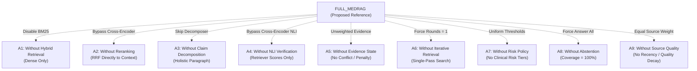

# Component Ablation Studies & Statistical Significance

**Framework**: MedRAG Standardized Leave-One-Out Ablation Framework  
**Objective**: Formally isolate and quantify the marginal contribution of each architectural module to diagnostic accuracy, evidence grounding, and clinical risk mitigation.  
**Applicability**: MedQA (USMLE), PubMedQA (PQA-L), and downstream clinical QA benchmarks.

---

## 1. Overview & Research Methodology

Complex medical reasoning systems cannot be validated solely by end-to-end benchmark scores. To understand *why* MedRAG works and confirm that performance gains are not spurious, we apply a rigorous **Leave-One-Out (LOO)** ablation protocol.

Starting from the fully enabled proposed system (`FULL_MEDRAG`), nine experimental variants are evaluated. In each variant, **exactly one architectural component is disabled**, holding all other hyperparameters, models, prompt structures, and random seeds strictly constant.



---

## 2. Canonical Ablation Dimensions

### Ablation 1: `ablation_no_hybrid` (Without Hybrid Retrieval)
- **Component Disabled**: Lexical BM25 keyword matching (`enable_hybrid = False`, `bm25_weight = 0.0`, `dense_weight = 1.0`).
- **Research Question**: Does dense semantic retrieval alone suffice for clinical QA, or is sparse lexical matching essential for exact medical nomenclature (e.g., drug dosages, rare eponyms)?
- **Hypothesis**: Disabling BM25 will degrade retrieval recall on queries containing specific medical entities and numerical cutoffs.

### Ablation 2: `ablation_no_reranking` (Without Neural Reranking)
- **Component Disabled**: Cross-encoder passage reranker (`enable_reranking = False`, `use_reranker = False`).
- **Research Question**: What is the value of full cross-attention reranking over raw reciprocal rank fusion scores?
- **Hypothesis**: Without cross-encoder reranking, noisy or tangential passages enter the context window, reducing answer grounding and factual precision.

### Ablation 3: `ablation_no_claim_decomposition` (Without Claim Decomposition)
- **Component Disabled**: LLM-driven atomic claim extraction (`enable_claim_decomposition = False`).
- **Research Question**: Is fine-grained claim-level decomposition necessary, or can candidate answers be verified as single holistic paragraphs?
- **Hypothesis**: Holistic verification conflates multiple factual assertions, failing to detect isolated factual errors in otherwise plausible answers.

### Ablation 4: `ablation_no_nli_verification` (Without NLI Verification)
- **Component Disabled**: Cross-encoder Natural Language Inference (`enable_nli_verification = False`).
- **Research Question**: Does sentence-level NLI verification improve answer correctness over relying directly on retriever similarity scores?
- **Hypothesis**: Disabling NLI verification increases factual hallucination because retrieval similarity measures topical relevance, not factual entailment.

### Ablation 5: `ablation_no_evidence_state` (Without Evidence State & Conflict Tracking)
- **Component Disabled**: Dynamic evidence state tracking and contradiction penalties (`enable_evidence_state = False`).
- **Research Question**: Does tracking cumulative evidence states and contradictions improve decision reliability?
- **Hypothesis**: Without contradiction tracking, contradictory statements in medical literature are ignored, leading to ungrounded or misleading conclusions.

### Ablation 6: `ablation_no_iterative` (Without Iterative Retrieval)
- **Component Disabled**: Multi-round gap retrieval (`enable_iterative = False`, `max_search_rounds = 1`).
- **Research Question**: What is the marginal performance gain of iterative, gap-driven search rounds over single-pass RAG?
- **Hypothesis**: Complex diagnostic vignettes requiring multi-hop evidence synthesis will experience significant accuracy drops when restricted to a single search round.

### Ablation 7: `ablation_no_risk_policy` (Without Risk-Aware Stopping)
- **Component Disabled**: Clinical risk tiering and adaptive threshold tightening (`enable_risk_policy = False`).
- **Research Question**: Does risk-aware adaptive stopping reduce diagnostic errors on critical patient queries?
- **Hypothesis**: Uniform static thresholds allow uncertain or unverified claims to pass on high-risk clinical scenarios, elevating selective risk.

### Ablation 8: `ablation_no_abstention` (Without Selective Abstention)
- **Component Disabled**: Risk-based and gap-driven abstention (`enable_abstention = False`).
- **Research Question**: What is the trade-off between coverage ($100\%$) and selective accuracy when the system is prohibited from abstaining?
- **Hypothesis**: Forcing the system to answer every question drastically increases diagnostic errors on ungrounded or contradictory topics.

### Ablation 9: `ablation_no_source_quality` (Without Source-Quality & Recency Weighting)
- **Component Disabled**: Source reliability and temporal recency decay weighting (`enable_source_quality_weighting = False`).
- **Research Question**: Does weighting evidence by source quality (journal tier) and publication recency improve clinical accuracy?
- **Hypothesis**: Treating all retrieved passages equally elevates outdated guidelines or low-quality reference notes over recent peer-reviewed randomized trials.

---

## 3. Statistical Significance Protocols (PART E)

To prevent reporting random noise as scientific findings, MedRAG implements paired statistical tests on matched example predictions:

### 1. McNemar's Test for Paired Binary Correctness
Given $N$ identical test questions evaluated by System A (`FULL_MEDRAG`) and System B (Ablated):
- **Contingency Table**:
  - $a$: Both systems correct
  - $b$: System A correct, System B incorrect
  - $c$: System A incorrect, System B correct
  - $d$: Both systems incorrect
- **Test Statistic**:
  - For small discordant samples ($b + c < 25$): **Exact two-tailed binomial test**:
    $$p = 2 \sum_{k=0}^{\min(b, c)} \binom{b+c}{k} 0.5^{b+c}$$
  - For large discordant samples ($b + c \ge 25$): **Edwards continuity-corrected $\chi^2$ test**:
    $$\chi^2 = \frac{(|b - c| - 1.0)^2}{b + c}, \quad \text{df}=1, \quad p = \operatorname{erfc}\left(\sqrt{\frac{\chi^2}{2}}\right)$$

### 2. Paired Empirical Bootstrap Resampling
For continuous and selective metrics (Accuracy, Selective Accuracy, Macro-F1, and Coverage):
- **Resampling Procedure**: Resample $N$ question indices with replacement $B = 1,000$ times using a fixed seed (`random_seed = 42`).
- **Difference Distribution**: Compute the paired metric delta $\Delta^{(b)} = \text{Metric}(A)^{(b)} - \text{Metric}(B)^{(b)}$ for each bootstrap sample $b \in \{1, \dots, B\}$.
- **95% Confidence Interval**: Form empirical percentile bounds $[\text{quantile}_{0.025}(\Delta), \text{quantile}_{0.975}(\Delta)]$.
- **Statistical Criterion**: An ablation delta is declared statistically significant at $\alpha = 0.05$ if and only if the 95% bootstrap confidence interval strictly excludes zero.

---

## 4. Scientific Guardrails & Limitations Notice

> [!CAUTION]
> **Reporting Standards**:
> - Never claim a statistically significant improvement merely because a metric is numerically higher.
> - Statistical significance ($p < 0.05$) demonstrates that an observed difference is unlikely under the null hypothesis of equal performance on this sample. It **does not** prove clinical safety or diagnostic equivalence.
> - Selective abstention is an intentional safety feature. Decreased coverage with higher selective accuracy represents conservative clinical alignment, not an operational failure.

---

## 5. Experiment Execution & CLI Usage

### Running the Complete Ablation Suite in One Command
```bash
# Run all 9 ablations + FULL_MEDRAG reference on MedQA
python eval.py \
  --dataset medqa \
  --split test \
  --study ablations \
  --corpus-dir data/medqa/textbooks \
  --backend groq \
  --model llama-3.3-70b-versatile \
  --output-dir runs/medqa_ablation_study

# Smoke test using mock LLM
python eval.py \
  --dataset synthetic \
  --split test \
  --study ablations \
  --limit 5 \
  --backend mock \
  --output-dir runs/smoke_ablations
```

### Generated Artifacts
Under `runs/<study_id>/`, the ablation engine saves:
- `ablation_table.md` / `ablation_table.json`: Table showing $\Delta \text{Acc}$, 95% bootstrap CIs, McNemar's $p$-values, and significance flags.
- `comparison_table.md`: Complete performance metrics across all 10 configurations.
- `per_example_comparison.csv`: Full per-example matrix showing which component failed on specific questions.
- `statistical_report.json`: Machine-readable paired statistical tests and contingency tables.
