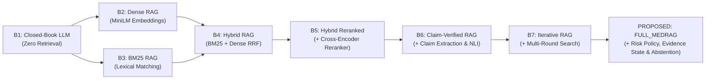

# Standardized Baseline Comparison Framework

**Framework**: MedRAG Standardized Empirical Baselines  
**Objective**: Quantify the cumulative performance gains of iterative evidence retrieval, neural reranking, claim-level verification, risk-aware stopping, and selective abstention relative to established clinical QA baselines.  
**Applicability**: MedQA (USMLE), PubMedQA (PQA-L), and downstream clinical QA benchmarks.

---

## 1. Overview & Research Objectives

Evaluating a multi-component clinical Retrieval-Augmented Generation (RAG) system requires establishing a rigorous progression of comparison systems. Simple closed-book generation or single-shot retrieval cannot reveal which architectural layer contributes to diagnostic accuracy, evidence grounding, or patient risk reduction.

MedRAG defines a standardized hierarchy of **seven baseline systems** leading up to the complete **proposed system (`FULL_MEDRAG`)**:



---

## 2. Canonical Baseline System Definitions

Each baseline configuration isolates a specific architectural capability while strictly freezing all non-evaluated parameters:

### Baseline 1: `CLOSED_BOOK_LLM` (`closed_book`)
- **Description**: The clinical vignette and options are passed directly to the generator without external retrieval.
- **Purpose**: Establishes the parametric memorization upper bound of the base foundation model.
- **Parameters**: `rounds = 0`, zero document context.

### Baseline 2: `SINGLE_PASS_DENSE_RAG` (`single_pass_dense_rag` / `dense_rag`)
- **Description**: Single-round dense embedding retrieval (e.g., `all-MiniLM-L6-v2`) followed by generation.
- **Purpose**: Measures the efficacy of standard dense vector similarity search without lexical matching or reranking.
- **Parameters**: `bm25_weight = 0.0`, `dense_weight = 1.0`, `use_reranker = False`, `max_search_rounds = 1`.

### Baseline 3: `SINGLE_PASS_BM25_RAG` (`single_pass_bm25_rag` / `bm25_rag`)
- **Description**: Single-round BM25 lexical keyword matching followed by generation.
- **Purpose**: Measures exact lexical term matching performance on specialized medical nomenclature (e.g., drug names, rare syndromes).
- **Parameters**: `bm25_weight = 1.0`, `dense_weight = 0.0`, `use_reranker = False`, `max_search_rounds = 1`.

### Baseline 4: `HYBRID_RAG` (`hybrid_rag`)
- **Description**: Fuses BM25 and dense retrieval using Reciprocal Rank Fusion (RRF) with default weights ($w_{\text{bm25}}=0.4, w_{\text{dense}}=0.6$).
- **Purpose**: Evaluates whether complementary sparse lexical and dense semantic signals outperform individual retrievers.
- **Parameters**: `enable_hybrid = True`, `use_reranker = False`, `max_search_rounds = 1`.

### Baseline 5: `HYBRID_RERANKED_RAG` (`hybrid_reranked_rag` / `reranked_rag`)
- **Description**: Single-round hybrid retrieval followed by cross-encoder neural reranking (`ms-marco-MiniLM-L-6-v2`) to prioritize the top-$k$ passages.
- **Purpose**: Measures the value of deep cross-attention passage relevance scoring over fusion heuristics.
- **Parameters**: `enable_hybrid = True`, `use_reranker = True`, `max_search_rounds = 1`.

### Baseline 6: `CLAIM_VERIFIED_RAG` (`claim_verified_rag`)
- **Description**: Single-round hybrid retrieval + reranking with candidate answer decomposition into atomic clinical claims and sentence-level NLI verification (`nli-MiniLM2-L6-H768`).
- **Purpose**: Determines the impact of claim extraction and formal NLI verification on answer accuracy and factual consistency.
- **Parameters**: `enable_claim_decomposition = True`, `enable_nli_verification = True`, `enable_iterative = False`.

### Baseline 7: `ITERATIVE_RAG` (`iterative_rag`)
- **Description**: Multi-round iterative retrieval (up to 3 rounds) driven by unresolved claim gap queries, but evaluated using fixed threshold stopping **without** clinical risk policy tiering.
- **Purpose**: Isolates the benefit of iterative multi-round search from risk-adaptive stopping logic.
- **Parameters**: `max_search_rounds = 3`, `enable_iterative = True`, `enable_risk_policy = False`.

### Proposed System: `FULL_MEDRAG` (`full_medrag`)
- **Description**: The complete MedRAG architecture integrating all components:
  1. Iterative hybrid retrieval (BM25 + Dense RRF).
  2. Cross-encoder neural reranking.
  3. Atomic claim decomposition.
  4. Sentence-level NLI verification.
  5. Multi-passage evidence state and contradiction tracking.
  6. Source-quality and temporal recency decay weighting.
  7. Risk-aware adaptive stopping policy.
  8. Selective abstention on unverified or contradictory claims.

---

## 3. Component Activation Matrix

The table below summarizes the exact component activations across all baseline configurations:

| Configuration | Hybrid RRF | Neural Reranker | Claim Extraction | NLI Verification | Evidence State | Multi-Round Search | Risk Policy | Selective Abstention |
| :--- | :---: | :---: | :---: | :---: | :---: | :---: | :---: | :---: |
| **`closed_book`** | ❌ | ❌ | ❌ | ❌ | ❌ | ❌ | ❌ | ❌ |
| **`single_pass_dense_rag`** | ❌ | ❌ | ❌ | ❌ | ❌ | ❌ | ❌ | ❌ |
| **`single_pass_bm25_rag`** | ❌ | ❌ | ❌ | ❌ | ❌ | ❌ | ❌ | ❌ |
| **`hybrid_rag`** | ✅ | ❌ | ❌ | ❌ | ❌ | ❌ | ❌ | ❌ |
| **`hybrid_reranked_rag`** | ✅ | ✅ | ❌ | ❌ | ❌ | ❌ | ❌ | ❌ |
| **`claim_verified_rag`** | ✅ | ✅ | ✅ | ✅ | ✅ | ❌ | ❌ | ✅ |
| **`iterative_rag`** | ✅ | ✅ | ✅ | ✅ | ✅ | ✅ | ❌ | ✅ |
| **`full_medrag` (Proposed)** | ✅ | ✅ | ✅ | ✅ | ✅ | ✅ | ✅ | ✅ |

---

## 4. Methodological Fairness Protocol (PART C)

To prevent biased comparisons, the `StudyRunner` enforces strict experimental fairness constraints across all baselines:

1. **Model Invariance**: Every baseline uses the identical LLM backend (e.g. `llama-3.3-70b-versatile`, `gpt-4o-mini`, or `mock`) and model weights.
2. **Corpus & Split Alignment**: All retrieval baselines query the exact same underlying knowledge corpus and split (e.g. MedQA textbook corpus or PubMed abstracts).
3. **Retrieval Budget**: Initial retrieval candidate pools (`top_k_retrieve = 20`) and context windows (`top_k_rerank = 5`) are held constant across all retrieval baselines.
4. **Sampling Determinism**: Sampling temperature (`temperature = 0.0`) and random seeds (`random_seed = 42`) are fixed.
5. **Prompt Standardization**: Vignette presentation, options format, and prompt instructions remain identical across all RAG baselines.
6. **Unified Evaluation Code**: Predictions from all systems are evaluated through identical normalization and scoring routines in `MetricRegistry`.

---

## 5. Experiment Execution & CLI Usage

### Running the Complete Baseline Suite in One Command
```bash
# Run all 8 baselines on MedQA test split
python eval.py \
  --dataset medqa \
  --split test \
  --study baselines \
  --corpus-dir data/medqa/textbooks \
  --backend groq \
  --model llama-3.3-70b-versatile \
  --output-dir runs/medqa_baseline_study

# Smoke test using mock LLM
python eval.py \
  --dataset synthetic \
  --split test \
  --study baselines \
  --limit 5 \
  --backend mock \
  --output-dir runs/smoke_baselines
```

### Generated Artifacts
Under `runs/<study_id>/`, the execution engine produces:
- `comparison_table.md` / `comparison_table.json`: Multi-system comparative table across all primary metrics.
- `per_example_comparison.csv` / `per_example_comparison.jsonl`: Example-by-example side-by-side predictions and correctness indicators.
- `statistical_report.json`: Paired statistical significance tests (McNemar's test and paired bootstrap CIs) comparing each baseline against `FULL_MEDRAG`.
- `<baseline_id>/`: Individual experiment subdirectories containing streaming predictions, manifests, and latency logs.
