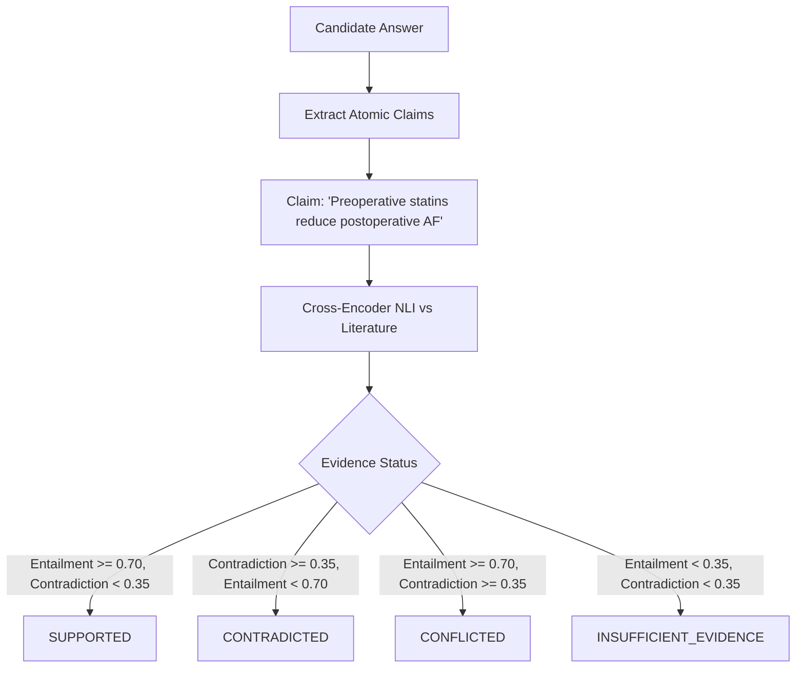

# PubMedQA (PQA-L Expert-Labeled Subset) Research Benchmark

**Dataset**: PubMedQA — Biomedical Question Answering from Scientific Abstracts  
**Official Source**: [https://github.com/pubmedqa/pubmedqa](https://github.com/pubmedqa/pubmedqa)  
**Website**: [https://pubmedqa.github.io/](https://pubmedqa.github.io/)  
**Task**: Categorical biomedical question answering (`yes`, `no`, `maybe`) with claim-level evidence attribution.

---

## 1. Overview & Research Objectives

The PubMedQA benchmark evaluates an AI system's ability to answer complex biomedical research questions using evidence synthesized from scientific abstracts (PubMed). Each question is paired with a PubMed Central article title, abstract passages, and an expert-adjudicated ground-truth decision (`yes`, `no`, or `maybe`).

In MedRAG, the PubMedQA benchmark investigates:
- **Biomedical Evidence Reasoning**: Generating answers grounded strictly in peer-reviewed scientific literature.
- **Claim-Level Evidence Verification**: Decomposing candidate answers into atomic assertions and verifying them with sentence-level Natural Language Inference (NLI).
- **Contradiction Detection**: Explicitly detecting when different studies or passages report conflicting findings.
- **Selective Answering & Risk-Aware Abstention**: Quantifying system uncertainty and abstaining when evidence is insufficient or contradictory.
- **Dual Retrieval & Reasoning Protocols**: Disentangling reading comprehension on provided evidence from external information retrieval across a biomedical corpus snapshot.

---

## 2. Dataset Specifications & Split Discipline

### PQA-L vs. PQA-U / PQA-A Subsets

PubMedQA comprises three distinct subsets:
1. **PQA-L (Expert-Labeled, 1,000 items)**: The primary research subset adjudicated by biomedical experts.
2. **PQA-U (Unlabeled, 61,249 items)**: Questions extracted from PubMed titles without expert labels.
3. **PQA-A (Artificial, 211,331 items)**: Automatically generated questions with heuristic labels.

> [!IMPORTANT]
> **Strict Subset Separation**: MedRAG's `PubMedQAAdapter` exclusively evaluates on the **expert-labeled PQA-L subset**. Artificially generated (PQA-A) and unlabeled (PQA-U) items are strictly excluded and will be rejected with an explicit error to prevent corrupting benchmark validity.

### Official Splits & Partitioning

MedRAG adheres to the official PubMedQA benchmark splits:

| Split | Question Count | Evidence Source | Purpose |
| :--- | :--- | :--- | :--- |
| **`train`** | 450 items | PubMed abstract passages | In-context exemplar selection / corpus calibration |
| **`dev` / `val`** | 50 items | PubMed abstract passages | **Prompt engineering, NLI threshold tuning & risk calibration** |
| **`test`** | 500 items | PubMed abstract passages | **Final benchmark evaluation only (FROZEN CONFIGURATION)** |

> [!WARNING]
> **Split Discipline**: NLI support/conflict thresholds and risk-aware stopping criteria must **only** be calibrated on the validation split (`--split val`). The configuration must be frozen (`config_hash` recorded in `manifest.json`) prior to running final evaluation on the official 500-question test split.

---

## 3. Dual Evaluation Protocols

To ensure rigorous scientific distinction between evidence reasoning and external search, MedRAG implements two separate evaluation protocols:

### Protocol 1: `PUBMEDQA_PROVIDED_CONTEXT`
- **Input**: Question + associated PubMed abstract context.
- **Execution**: The generator receives the reference scientific abstract directly in the prompt.
- **Rounds**: 0 retrieval rounds (reading comprehension).
- **Claim Verification**: Extracted claims are verified against the provided abstract passages.
- **Reporting Rule**: This protocol measures *answer reasoning given supplied evidence* and is **never** labeled as external retrieval performance.

### Protocol 2: `PUBMEDQA_RETRIEVAL`
- **Input**: Question **only**.
- **Execution**: MedRAG searches an external documented biomedical corpus (BM25, dense embeddings, or hybrid RRF).
- **Leakage Prevention**:
  - The benchmark-associated abstract is **not** supplied directly to the generator.
  - Benchmark questions and gold labels are **not** indexed in the corpus.
- **Provenance Tracking**: Records retrieved PMIDs, chunk IDs, rankings, and whether the reference PMID was retrieved.
- **Metrics**: Evaluates both answer correctness and retrieval performance (Recall@k, MRR, nDCG@k).

---

## 4. Claim-Level Evidence Verification (Taxonomy)

Candidate answers are decomposed into atomic, independently verifiable clinical claims. Each claim is verified against evidence passages using Natural Language Inference (NLI).



### 4-Way Verification Taxonomy:
1. **`SUPPORTED`**: Credible evidence entails the claim without material contradiction ($\text{entailment} \ge 0.70, \text{contradiction} < 0.35$).
2. **`CONTRADICTED`**: Credible evidence directly refutes the claim ($\text{contradiction} \ge 0.35, \text{entailment} < 0.70$).
3. **`CONFLICTED`**: Different passages in the literature report contradictory findings ($\text{entailment} \ge 0.70$ and $\text{contradiction} \ge 0.35$).
4. **`INSUFFICIENT_EVIDENCE`**: Neither credible support nor refutation exists in the retrieved documents ($\text{entailment} < 0.35, \text{contradiction} < 0.35$).

> [!CAUTION]
> **NLI Epistemic Boundary**: Natural Language Inference scores reflect linguistic entailment between texts. They must **never** be interpreted or reported as calibrated clinical probabilities or statistical significance.

---

## 5. Structured Answer Generation & Controlled Recovery

MedRAG enforces structured JSON responses for PubMedQA:

```json
{
  "prediction": "yes|no|maybe",
  "explanation": "Trial showed a statistically significant 45% reduction in transfusions.",
  "claims": [
    "Tranexamic acid reduces allogeneic red blood cell transfusions in cardiac surgery.",
    "Thrombotic adverse event rates did not increase compared to placebo."
  ],
  "citations": ["24985223"],
  "abstain": false
}
```

### Controlled Recovery & Safe Abstention:
- **Direct JSON Extraction**: Parses response directly or from markdown blocks (````json ... ````).
- **Explicit Abstention Handling**: When `"abstain": true` is returned, the item is recorded as abstained.
- **Conflicting Signal Detection**: If an output asserts both "yes" and "no" across differing rationale sentences, MedRAG detects the conflict and safely **abstains** (`norm_answer = None`).
- **Ambiguity Fallback**: If the output contains unresolvable ambiguity, the system abstains rather than making an unverified guess.

---

## 6. Scientific Evaluation Metrics

MedRAG computes a complete suite of standard and selective classification metrics, along with information retrieval statistics:

### Classification & Selective Answering Metrics:
- **Raw Accuracy**: $\frac{\text{Correct}}{\text{Total}}$ (abstentions penalized as incorrect).
- **Selective Accuracy**: $\frac{\text{Correct}}{\text{Evaluated (Answered)}}$.
- **Selective Risk**: $1.0 - \text{Selective Accuracy}$.
- **Coverage**: $\frac{\text{Evaluated}}{\text{Total}} = 1.0 - \text{Abstention Rate}$.
- **Macro-F1**: Unweighted mean of F1 scores across the three classes (`yes`, `no`, `maybe`).
- **Per-Class Precision & Recall**: Precision and recall calculated independently for `yes`, `no`, and `maybe`.
- **Confusion Matrix**: Full contingency table mapping Gold rows against Predicted columns (`yes`, `no`, `maybe`, `ABSTAIN`, `OTHER`).
- **AURC**: Area Under the Risk-Coverage Curve across varying confidence thresholds.

### Retrieval Metrics (Protocol 2 Only):
- **Recall@1, Recall@5, Recall@10**: Proportion of queries where the reference PubMed abstract was retrieved in the top-$k$ results.
- **MRR (Mean Reciprocal Rank)**: $\frac{1}{N} \sum_{i=1}^N \frac{1}{\text{rank}_i}$ of the reference PMID.
- **nDCG@5, nDCG@10**: Normalized Discounted Cumulative Gain against the reference evidence.

---

## 7. Official Evaluation Compatibility

MedRAG exports all predictions in the exact format required by the official PubMedQA benchmark:

```json
{
  "21645374": "yes",
  "28342119": "no",
  "19401723": "maybe"
}
```

- **Output Path**: Automatically saved to `runs/<experiment_id>/official_pubmedqa_predictions.json`.
- **Official Evaluation**: `PubMedQAAdapter.evaluate_official_predictions()` computes official benchmark accuracy and Macro-F1 identically to the benchmark repository's `evaluation.py`.

---

## 8. CLI Usage Guide

### Smoke Test (Mock LLM, Fast Validation)
```bash
# Protocol 1: Provided Context (zero retrieval)
python eval.py \
  --dataset pubmedqa \
  --split test \
  --protocol pubmedqa_provided_context \
  --limit 5 \
  --experiment-id pqa_prov_smoke

# Protocol 2: External Retrieval
python eval.py \
  --dataset pubmedqa \
  --split test \
  --protocol pubmedqa_retrieval \
  --limit 5 \
  --experiment-id pqa_ret_smoke
```

### Full Research Evaluation (Production Backend)
```bash
# 1. Validation Split (Hyperparameter & Threshold Calibration)
python eval.py \
  --dataset pubmedqa \
  --split dev \
  --protocol pubmedqa_provided_context \
  --backend gemini \
  --model gemini-2.5-flash \
  --experiment-id pqa_prov_val

# 2. Test Split Evaluation (Frozen Configuration)
python eval.py \
  --dataset pubmedqa \
  --split test \
  --protocol pubmedqa_provided_context \
  --backend gemini \
  --model gemini-2.5-flash \
  --experiment-id pqa_prov_test_frozen

# 3. External Retrieval with Documented Biomedical Corpus
python eval.py \
  --dataset pubmedqa \
  --split test \
  --protocol pubmedqa_retrieval \
  --corpus-dir data/biomedical_corpus \
  --backend gemini \
  --model gemini-2.5-flash \
  --experiment-id pqa_ret_test_frozen
```

---

## 9. Clinical Safety & Abstention Notice

> [!IMPORTANT]
> **Clinical Ethics & Patient Safety**:
> High benchmark performance on PubMedQA demonstrates biomedical question answering capability over published abstracts. It **does not** constitute evidence of clinical safety or diagnostic efficacy in real-world clinical practice.
>
> In real clinical environments, uncalibrated guessing carries grave patient risks. MedRAG treats **selective abstention** when evidence is conflicting or insufficient as a fundamental safety feature, not a failure mode.
